<div align="center">

# ⚙️ TMG Maximo Development · `maxdev`

### AI-powered, config-as-code development for IBM Maximo Application Suite 9

**Pull it. Version it. Diff it. Ship it — with an AI agent at your side.**

[](LICENSE)
[](pyproject.toml)
[](docs/COVERAGE.md)
[](docs/AGENT_SETUP.md)
<br/>
[](maxdev/registry.yaml)
[](tests/)
[](#-safety-by-design)
[](https://themaximoguys.ai)

</div>

---

**`maxdev` turns IBM Maximo into a codebase.** Every domain, object, App Designer
screen, automation script, workflow, security group, integration and dashboard in
your Manage environment becomes one reviewable file in Git — pulled from and pushed
back to Maximo **through Maximo's own REST APIs**. No database hacks, no
hand-copied XML, no "who changed that in production?" moments. You get diffs,
history, code review and repeatable deployments for a platform that has
historically lived only inside its own UI.

**And it was built for AI from day one.** The same engine is exposed as a CLI *and*
as an MCP server, so Claude, Gemini, ChatGPT/Codex, Mistral, IBM Bob or any other
MCP-capable coding agent can extract configuration, write TMG-standard Jython
automation scripts, convert legacy Java and TRM customisations, and deploy to DEV
— under exactly the same dry-run, lint and protected-environment rules you work
under. Your team describes the change; the agent does the Maximo plumbing.

<br/>

<div align="center">

## 🤖 Works with your favourite AI

<table>
  <tr>
    <td align="center" width="140">
      <picture>
        <source media="(prefers-color-scheme: dark)" srcset="https://cdn.jsdelivr.net/npm/@lobehub/icons-static-png@1.80.0/dark/claude-color.png">
        
      </picture>
      <br/><b>Anthropic</b><br/><sub>Claude Code</sub>
    </td>
    <td align="center" width="140">
      <picture>
        <source media="(prefers-color-scheme: dark)" srcset="https://cdn.jsdelivr.net/npm/@lobehub/icons-static-png@1.80.0/dark/gemini-color.png">
        
      </picture>
      <br/><b>Google</b><br/><sub>Gemini CLI</sub>
    </td>
    <td align="center" width="140">
      <picture>
        <source media="(prefers-color-scheme: dark)" srcset="https://cdn.jsdelivr.net/npm/@lobehub/icons-static-png@1.80.0/dark/openai.png">
        
      </picture>
      <br/><b>OpenAI</b><br/><sub>Codex</sub>
    </td>
    <td align="center" width="140">
      
      <br/><b>IBM</b><br/><sub>Bob</sub>
    </td>
    <td align="center" width="140">
      <picture>
        <source media="(prefers-color-scheme: dark)" srcset="https://cdn.jsdelivr.net/npm/@lobehub/icons-static-png@1.80.0/dark/mistral-color.png">
        
      </picture>
      <br/><b>Mistral AI</b><br/><sub>any MCP client</sub>
    </td>
  </tr>
</table>

<sub>Agent instructions ship as <code>AGENTS.md</code>, <code>CLAUDE.md</code> and <code>GEMINI.md</code>; the <code>tmg-maximo-dev</code> MCP server works with any MCP client. See the <a href="docs/AGENT_SETUP.md">agent setup guide</a>.</sub>

</div>

---

## 🧠 The automation orchestration layer for IBM MAS development

Maximo development has always meant a tour of screens: Database Configuration,
Domains, App Designer, Automation Scripts, Workflow Designer, Security Groups,
Object Structures — each with its own export format and its own way to break
production. `maxdev` puts **one orchestration layer** over all of it. A single
`registry.yaml` describes 46 artifact types, their REST object structures, their
keys and their dependency layer (0 foundation → 11 reporting). Change sets are
plain YAML manifests, one per ticket, that the engine resolves, orders, lints,
dry-runs and deploys — writing a receipt of exactly what landed, backing up and
merging App Designer screens, and restoring formulas automatically if a re-create
fails.

On top of that engine sits the **agent layer**. Repo skills (`maximo-dev`,
`maximo-dev-engine`, `create-automation-script`, `convert-java-to-script`,
`convert-trm-to-script`, `maximo-workflow`) teach any coding agent the TMG way to
run a ticket end to end: read the spec, call design-phase specialists only where a
requirement needs them, generate scripts from 28 TMG templates, build dashboards
from one YAML spec, then dry-run and wait for human approval before anything
touches Maximo. The result is an AI teammate that knows Maximo's APIs, your
standards and your guard-rails — and an orchestration layer that makes its work
reviewable, repeatable and safe.

<p align="center">
  
</p>

---

## ✨ What you can build and ship

| | Area | What `maxdev` handles |
|:-:|---|---|
| 🗄️ | **Database Configuration** | Objects, attributes, relationships, indexes — plus `dbconfig status` for pending applies |
| 📚 | **Domains & conditions** | ALN / numeric / table / crossover domains, conditional expressions |
| 🖥️ | **App Designer** | Whole-screen XML with live backup, three-way merge and read-back check |
| 🐍 | **Automation scripts** | 28 TMG templates, linting to TMG standards, Java and TRM conversion |
| 🔀 | **Workflows & escalations** | Processes, actions, roles, cron tasks |
| 🔐 | **Security** | Groups, sig options, grants, app/object-structure rights |
| 🔗 | **Integration** | Object structures, publish channels, enterprise services, endpoints |
| 📊 | **Dashboards** | Operational Dashboard views + start centers, KPIs, work queues — from one YAML spec |
| 🧩 | **IBM tooling** | Optional IBM Maximo MCP server through the same safety checks |

<sub>Full map in <a href="docs/COVERAGE.md">docs/COVERAGE.md</a>.</sub>

---

## 🚀 Quick start

```bash
pip install -r requirements.txt            # requests, PyYAML, mcp
# fill environments/.env.demo (git-ignored, starts read-only)
python3 -m maxdev ping --env demo          # who am I
python3 -m maxdev doctor --env demo        # which object structures exist for every type
python3 -m maxdev bootstrap authapps --env demo  # set auth app on IBM MX* structures (dry run; --apply)
python3 -m maxdev bootstrap --env demo     # TMG structures only where IBM has none usable (dry run; --apply)
```

> [!TIP]
> `pip install -e .` also gives you the `maxdev` and `maxdev-mcp` commands.
> Coding agents start with [AGENTS.md](AGENTS.md) and the [setup guide](docs/AGENT_SETUP.md).

## 🔁 Daily loop

```bash
maxdev extract domain --like TMG            # pull TMG* domains into src/03-domains/
maxdev extract autoscript WORKORDER.SAVE    # one script -> src/09-automation-scripts/object/
maxdev extract appxml WOTRACK               # screen XML -> src/07-app-designer/WOTRACK.xml
maxdev build field_validate --object WORKORDER --attr CUSTOMER_EMAIL   # TMG template -> src/09-...
maxdev lint                                 # TMG standards; deploy refuses lint errors
maxdev java analyze legacy/FldWOEmail.java  # which template a Java class converts to
# ... edit files ...
maxdev diff --path src/03-domains           # repo vs live
maxdev deploy --manifest WO-CUSTOMER-EMAIL  # dry run: shows create/update/merge per file
# Only after approval of the dry run above:
maxdev deploy --manifest WO-CUSTOMER-EMAIL --apply
maxdev dbconfig status                      # objects with unapplied Database Configuration
```

## 📊 Dashboards

One YAML spec (`catalog/dashboards/`) builds an Operational Dashboard view and/or a
start center, plus the security group and its rights, saved queries, KPIs and work queues behind them.
The generated manifest deploys them in order and lists the steps no API covers
(group assignment, cards). See
[skills/maximo-dev/references/dashboards.md](skills/maximo-dev/references/dashboards.md).

```bash
maxdev dashboard check maintenance_supervisor
maxdev dashboard build maintenance_supervisor       # src/ files + manifests/TMG_OPS_SUPERVISOR.yaml
maxdev deploy --manifest TMG_OPS_SUPERVISOR --env demo   # dry run; --apply after approval
```

## 🛡️ Safety by design

This repo deliberately contains **no CI/CD or pipelines**. It is the development
layer: extract, edit, diff, deploy to DEV, verify. Promotion beyond DEV is a
separate release process; mark those environments `MAXIMO_PROTECTED=true` and
this tool refuses to write to them.

> [!IMPORTANT]
> Every live write is a **dry run first**. Nothing is applied until a human approves it.

- 🧭 Deploy always runs in dependency order (layer 0 foundation → 11 reporting) and stops at the first failure. Maximo config writes are not a transaction, so the receipt in `.maxdev/receipts/` records exactly what landed.
- 🔑 Upserts look a record up by its key, then merge into it or create it. A key that matches more than one record is refused rather than guessed.
- ♻️ Formulas and conditional UI are deleted and re-created, with a read-back check. If the re-create fails, the old rows are restored automatically.
- 🖥️ App Designer XML is a whole-screen document, so deploy:
  - backs up the live screen first;
  - merges the repo copy on top of the live one, so changes made in the UI survive;
  - reads the screen back to catch a write the server silently dropped.

## 🗂️ Layout

| Path | What |
|---|---|
| `src/NN-*/` | Artifacts, one file per record, a folder per area (see [docs/COVERAGE.md](docs/COVERAGE.md)) |
| `manifests/*.yaml` | Change sets: one per feature/ticket, including manual steps |
| `catalog/dashboards/*.yaml` | Dashboard specs for `maxdev dashboard` |
| `src/00_predeployment/` | **Deploy first, once per environment.** TMG helper object structures + `TMG_EXPORT_PRES` script (see its README) |
| `maxdev/` | Engine, CLI, MCP server, IBM MCP client, script and dashboard builders. `registry.yaml` drives everything |
| `catalog/` | TMG script templates (28) and samples (69), from TMG_MAX_CODE (MIT) |
| `docs/standards/` | TMG_AUTOSCRIPT_STANDARDS.md (authoritative) |
| `docs/autoscript/` | Patterns, naming, error handling, launch points, Java/TRM conversion guides, knowledge base |
| `postman/collections/` | Generic MAS 9 config + App Designer collections, for manual API exploration |
| `docs/` | Coverage map, application development, IBM tooling, API notes, standards |
| `skills/` | `maximo-dev`, `maximo-dev-engine`, `create-automation-script`, `convert-java-to-script`, `convert-trm-to-script`, `maximo-workflow` |
| `tests/` | Offline tests against an in-memory fake Manage API (`python3 -m unittest discover -s tests`) |

## 🔌 MCP

The local **tmg-maximo-dev** server exposes the same engine to MCP clients.
`.mcp.json` configures Claude Code; `config/agents/codex.toml` is the Codex
project configuration. See [agent setup](docs/AGENT_SETUP.md) for discovery,
installation, other clients, and verification. The CLI works without MCP.

IBM MCP is optional and accessed through `maxdev ibm-mcp` or the wrapper's
`ibm_mcp_*` tools so the same apply/protected-environment checks remain in place.
No credentials or default tenant are embedded in shared client configuration.

## 📈 Status

**Live on the TMG demo (MAS 9):** `maxdev doctor` reports 41 of the 43 REST areas `ok` (SLAs and response plans have no structure there; 3 more areas are manual by design), and the bootstrap structures are installed. A sample dashboard (12 records, including an Operational Dashboard view and its group rights) is deployed and re-diffs `same`. Write path proven: bootstrap created 16 records, and the export script was updated and verified live. On a new tenant, dry-run and obtain approval before applying: `maxdev bootstrap authapps --apply` sets the authorisation app on 6 IBM MX\* structures; then `maxdev bootstrap --apply` creates 10 TMG structures, only for areas that have no REST-usable IBM structure.

The engine, formats and safety rules are tested offline (run the test command for the current count). These items still need a live check on a TMG tenant:
- Object-structure names marked `verify` in `maxdev types`; run `maxdev doctor` to check them.
- The Admin Mode and Migration Manager service paths.
- The IBM MCP server route.

The reference repo verified the `ok` names on a MAS 9 tenant.

---

## 📜 License

Released under the **[MIT License](LICENSE)** — free to use, modify and
distribute. Copyright (c) 2026 TheMaximoGuys LLC. Third-party notices are in
[NOTICE](NOTICE).

IBM, Maximo and IBM Maximo Application Suite are trademarks of IBM. Anthropic,
Claude, Google, Gemini, OpenAI, Codex, Mistral AI and IBM Bob are trademarks of
their respective owners; logos are shown only to indicate compatibility. This
product is not affiliated with or endorsed by any of them and contains no IBM code.

<div align="center">
<br/>

**Built with ❤️ by [TheMaximoGuys](https://themaximoguys.ai)** · Questions, training or enterprise support: [hello@themaximoguys.ai](mailto:hello@themaximoguys.ai)

⭐ **If `maxdev` saves you a trip through App Designer, give it a star!**

</div>
